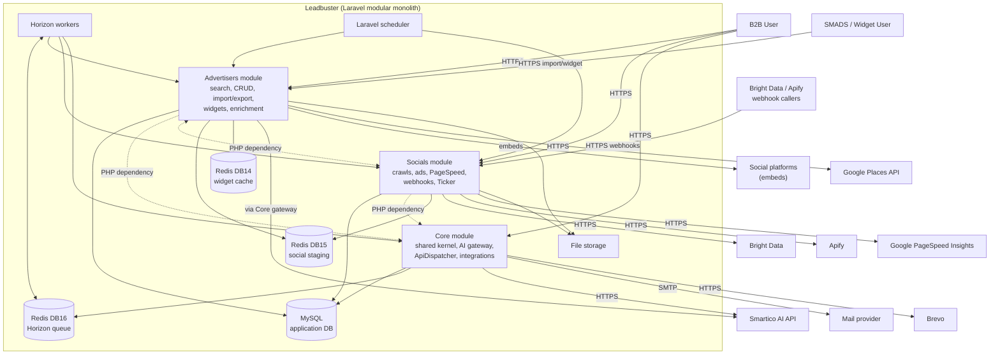

# Leadbuster — Architecture

Living document. Update it when a module boundary, data store, integration, or
deployment path changes — don't let it drift from `deptrac.php` and the
`module-architecture` skill, which remain the enforced source of truth for
backend layering.

**Related docs** — this file is the system-design narrative; detail lives
elsewhere:

- `DESIGN.md` — why the architecture is shaped this way (design rationale,
  the new-endpoint checklist).
- `CONVENTIONS.md` — coding conventions and style rules.
- `COMMANDS.md` — setup, run, lint, and Artisan command reference.
- `TESTING.md` — test strategy, locations, and known constraints.
- `SECURITY.md` — authentication, authorization, and other security controls.
- `docs/adr/` — architecture decision records for individually-tracked
  exceptions and deferred choices.
- `.ai/repo-map.md` — file/directory map of the repo.

## 1. Project Structure

Leadbuster is a Laravel modular monolith (`nwidart/laravel-modules`) with a
single global React/Inertia frontend. Three modules, one internal layering
convention, enforced by `deptrac.php` + PHPStan level 8:

```
Modules/
├── Core/          shared kernel — never depends on Advertisers or Socials
│   └── app/{Contracts,Services,Repositories,Builders,Models,Http,Jobs,
│            Mail,Notifications,Providers,Enums,Exceptions,Concerns,...}
├── Advertisers/   advertiser domain — CRUD, search/filter, import/export, widgets
│   └── app/{...same layer shape as Core...}
└── Socials/       social platform integrations — scrapers, profiles, posts, Ticker
    └── app/{...same layer shape as Core...}

resources/js/               global Inertia/React frontend (not per-module)
├── pages/{Advertisers,Auth,Core,Errors,Users}/   page folders mirror the owning module
├── components/, layouts/, hooks/, utils/, types/

app/                         framework-level app code (User model, base providers,
                             auth controllers, App\Support test-isolation helpers)
routes/                      root web/auth/console routes
config/                      Laravel + package config
database/                    root migrations/seeders (legacy/shared tables)
└── schema/                  committed schema snapshot used to build test templates
bin/                         worktree setup/doctor/test runner, schema snapshot, quality hooks
.github/workflows/           CI (ci.yml) and secret scanning (gitleaks.yml)
tests/
├── Feature/<Module>/...     full-chain feature tests (route → controller → service → repository)
└── Unit/Modules/<Module>/...

docs/
├── MEMORY.md                          durable cross-session project memory
├── structurizr/modules_overview_structurizr.dsl   C4 model source (Structurizr DSL) — canonical
│                                       component/relationship inventory this doc summarizes
├── specs/                             per-ticket specs
└── tasks/                             per-ticket plan/todo working notes

.claude/skills/module-architecture/   enforced backend layering rules (see §3)
```

Each module has the same core shape: `Http/{Controllers,Requests,
Resources,Middleware}`, `Services`, `Contracts`, `Repositories`, `Builders`,
`Models`, `Providers`, `Jobs`, `Console/Commands`, `database/{migrations,
factories,seeders}`, `routes/{api,web}.php`. Modules add `Data`
(`spatie/laravel-data` DTOs), `Events`, `Listeners`, `Enums` and `Policies`
where they need them.

## 2. High-Level System Diagram



This is a summary view. The full C4 model (context → container → component,
with every relationship) is maintained in
`docs/structurizr/modules_overview_structurizr.dsl` — treat that file as
canonical and this section as its digest.

## 3. Core Components

### 3.1 Modules

- **Core** — shared kernel: base repository contracts (`BaseIndexRepository`,
  `BaseShowRepository`, `BaseWriteRepository`, `BaseUpdateRepository`,
  `BaseDestroyRepository`), the `ApiDispatcher` (shared HTTP client wrapper for
  provider calls), the AI gateway (`BaseAI`/`OpenAI` → Smartico AI API; the
  Advertisers AI Summary job calls its own route `/v1/ai/advertiser-snapshot/ai-summary`
  through `BaseAI::advertiserSnapshotSummary()`, from `AdvertiserAiSummaryService`), the
  `CrawlTarget` enum (central mapping of crawl names → Redis keys, queue
  names, dispatch jobs), `BrightDataQueue` model, integration context, shared
  mail/completion jobs, exceptions, and cross-cutting concerns. It also owns
  user management (list, change integration, deactivate/reactivate),
  invitations, account settings, and Brevo contact sync driven by the
  `UserActivated` / `UserEmailChanged` events. Never depends on Advertisers
  or Socials.
- **Advertisers** — advertiser domain: search/filter/detail APIs, bulk
  import/export (queued Excel import → `FillAdvertiserDataFromAI` enrichment
  per row), SMADS/widget endpoints, categories, hidden-advertiser workflow,
  website metadata, ad-stat aggregation (monthly totals recomputed on the
  Socials `SocialAdMonthsRecomputed` event, see ADR-0007), contact persons,
  activity notes, CRM ID management, advertiser onboarding, and Google
  Places search.
- **Socials** — social platform integrations: profile/post crawls (Facebook,
  Instagram, LinkedIn, YouTube) via Bright Data, Google/Meta ad scraping via
  Apify, PageSpeed checks (one row per website and strategy), provider
  webhook handling, AI business snapshots, and the Ticker (paid-ad event
  feed, presets, exports).

### 3.2 The layer chain (enforced, `deptrac`-checked)

Every persistence-backed feature follows the same chain in all three modules
— full detail and canonical code examples live in the `module-architecture`
skill (`.claude/skills/module-architecture/SKILL.md`); summary:

```
Route → Controller → FormRequest → Service → Contract (interface)
      → Repository → Builder → Model
```

- **Controller** — thin, constructor-injects the **service**. Api controllers
  return `JsonResponse`; Web controllers return `Inertia::render()`.
- **FormRequest** — all validation; controllers pass `$request->safe()`
  (`ValidatedInput`) onward.
- **Service** — orchestration, depends on the repository **interface** only,
  owns pagination.
- **Contract** — module interface composed from Core's segregated base
  contracts.
- **Repository** — `final`, constructor-injects the Eloquent **model**,
  returns the module's custom **Builder**, no pagination.
- **Builder** — `final`, extends `Modules\Core\Builders\BaseBuilder`,
  chainable domain-named scopes.
- **Model** — Eloquent models, hook the custom builder via
  `newEloquentBuilder()`.

DI bindings live in each module's ServiceProvider (`bindContexts()`, scoped
bindings) — never resolved via `app()`/`resolve()` inside services.

### 3.3 Cross-module boundaries

Cross-module reads go through the owning module's repository/service, never
direct queries against another module's tables. Core is the only shared
dependency. Two documented, deliberate exceptions (do not "fix" without
re-opening the decision):

- `AdvertiserController::index()` runs raw, day-cached aggregate queries
  against Socials-owned tables — see
  `docs/adr/0001-cross-module-raw-aggregate-query-exception.md`.
- Advertisers and Socials tolerate cross-importing each other's enums only —
  see `docs/adr/0002-advertisers-socials-enum-cross-import-exception.md`.

### 3.4 Frontend

Installed versions now match the declared majors: React 19.3.1,
`@inertiajs/react` 3.9.1, Vite 8, Tailwind CSS 4, TypeScript 7 (checked in
`node_modules` on 2026-11-03). The gap that
`docs/adr/0005-frontend-declared-vs-installed-package-versions.md` describes
no longer exists. The ADR has not been superseded.

The visual design system (Figma Light, `lb-*` tokens in
`resources/css/app.css`, Manrope) is specified in
`docs/specs/DESIGN-SYSTEM-SPEC.md`.

Global app under `resources/js` (not per-module). Page
folders group by owning backend module; the rule going forward is that a
_new_ page's folder mirrors the module that owns its data. Existing
misplaced pages (e.g. Ticker under `pages/Advertisers/`) stay as-is — moves
are the frontend developer's call, not an agent's.

## 4. Data Stores

| Store                | Technology                                      | Purpose                                                                                                                                                           |
| -------------------- | ----------------------------------------------- | ----------------------------------------------------------------------------------------------------------------------------------------------------------------- |
| Application DB       | MySQL                                           | Integrations/users, advertisers, websites, categories, social profiles/posts/ads, PageSpeed, media, Ticker events, business snapshots, jobs/batches/failed_jobs   |
| Horizon queue Redis  | Redis (DB 16 by default, `REDIS_DB`)            | Default queue connection; Horizon workers consume import, enrichment, social crawl, ad-scraping, PageSpeed, and mail/notification queues                          |
| Social staging Redis | Redis (DB 15, `REDIS_DB_HORIZON_SOCIALS`)       | Pre-dispatch staging: `queue:{target}`, `queue:{target}_posts`, `queue:social_profiles_verify`, `concurrency:{target}`, provider batches                          |
| Widget cache Redis   | Redis (DB 14, `REDIS_WIDGET_DB`)                | Caches public widget responses: `widget_posts:{advertiser}:{newspaper}:{offset}:{limit}`                                                                          |
| Cache Redis          | Redis (DB 1 by default, `REDIS_CACHE_DB`)       | Laravel `cache` Redis connection                                                                                                                                  |
| File storage         | Laravel filesystem (local disk, `storage_path`) | Import files, generated advertiser/Ticker exports, compressed media, public widget assets; `meta_ads` disk serves ad media under `/storage/blockstorage/meta_ads` |
| Logs                 | Laravel logging (`LOG_CHANNEL=stack`)           | Provider, import, AI, crawler, webhook, and website-tech logs                                                                                                     |

No table-schema catalog is kept here. Use Boost's `database-schema` tool or
the committed snapshot `database/schema/mysql-schema.sql` (60 tables,
including legacy tables such as `advertisers` that predate the migration
history). Test databases are cloned from that snapshot; see `TESTING.md`.

## 5. External Integrations / APIs

| Integration                                               | Used by                                                            | Purpose                                                                                                                                                                                    |
| --------------------------------------------------------- | ------------------------------------------------------------------ | ------------------------------------------------------------------------------------------------------------------------------------------------------------------------------------------ |
| Smartico AI API                                           | Core `ApiDispatcher`/AI gateway, called from Advertisers + Socials | Website scraping, Google Place lookup, geocoding, social-profile verification, social-post categorisation, advertiser categorisation, website-technology extraction, AI business snapshots |
| Bright Data                                               | Socials (`BrightDataSocialsService`)                               | Social profile/post dataset crawling (Facebook, Instagram, LinkedIn, YouTube); async webhook delivery, tracked via `BrightDataQueue`                                                       |
| Apify                                                     | Socials (`ApifyAPIService`, `RunApifyAdScraperCommand`)            | Google Ads and Meta Ads actor runs + dataset reads; async webhook delivery                                                                                                                 |
| Google Places API                                         | Advertisers (`GooglePlacesSearchService`, `GOOGLE_PLACES_API_KEY`) | Place lookup for advertiser onboarding, `advertisers:recover-shared-websites` and the address backfill command                                                                             |
| Brevo                                                     | Core (`BrevoContactSyncService`, `BREVO_*`)                        | Syncs activated users and changed emails to Brevo contact lists                                                                                                                            |
| Google PageSpeed Insights                                 | Socials (`PageSpeedAPIService`)                                    | Desktop/mobile website performance metrics, measured per website by the daily `advertisers:page_speed` run and the advertiser import                                                       |
| Social platforms (Facebook, Instagram, LinkedIn, YouTube) | Advertisers widgets                                                | Embedded post content in the public advertiser widget                                                                                                                                      |
| Mail provider                                             | Core shared mail/completion jobs                                   | Import/export completion, advertiser request, and suggestion mail                                                                                                                          |
| Google Sheets / Translate                                 | Core (`GOOGLE_SERVICE_*`, `tanmuhittin/laravel-google-translate`)  | Optional service-account integration, translation                                                                                                                                          |
| PostHog                                                   | Frontend (`VITE_PUBLIC_POSTHOG_*`)                                 | Product analytics (EU host)                                                                                                                                                                |

All outbound provider HTTP calls go through Core's `ApiDispatcher` (base
URLs, prefixes, headers, bearer tokens, timeouts, JSON payload/response
handling) rather than ad-hoc `Http::` calls per module.

## 6. Deployment & Infrastructure

**Current state (2026-11-03): deploys are `git pull`-based** and MySQL runs
on the same host as the app.

**CI exists** ([ADR-0008](docs/adr/0008-shared-quality-hooks-and-ci-gate.md)).
`.github/workflows/ci.yml` runs these jobs, and the `CI gate` job requires
all of them:

- quality (pre-commit hooks on changed files);
- frontend (Vitest with coverage, `tsc` + build);
- backend static (PHPStan, deptrac);
- dependency audit;
- backend tests (Pest through `composer test`).

`gitleaks.yml` scans every new commit. `.github/dependabot.yml` is present.
Branch-rule enforcement is pending until an administrator activates it.

The deployment part of the blueprint is still not adopted
(`docs/adr/0003-git-pull-deploys-cicd-blueprint-not-adopted.md`). ADR-0003
still says `.github/workflows/` is empty; ADR-0008 records CI adoption
alongside it. The blueprint lists:

- `ci.yml` — Pint, PHPStan, Pest (MySQL + Redis service containers), `yarn
lint`/`yarn build`
- `codeql.yml`, `gitleaks.yml` — security/secret scanning
- `deploy-staging.yml`, `deploy-production.yml` — atomic release deploys
  (build → package → upload → symlink switch → Horizon restart), replacing
  `git pull`
- `.github/dependabot.yml` — composer + npm dependency updates
- `docs/infrastructure.md` (inside that folder) — full blueprint: target
  DigitalOcean droplet topology (nginx/php-fpm/redis/systemd/cron, no
  Docker), tag-driven production releases (`prod-YYYY-MM-DD.N`), 99.97% SLA
  target, and required decisions (per-environment `.env` files, release
  cadence, monitoring stack: UptimeRobot + Sentry + centralized logs).

Runtime, as it exists today:

- **Web**: PHP-FPM serving Laravel; Inertia SSR is automatic in Vite dev mode
  via `@inertiajs/vite`, no separate Node server needed.
- **Queues**: `laravel/horizon` (v5) supervises Redis-backed queues; local
  dev instead uses `php artisan queue:listen` via `composer run dev`.
  Supervisors are split by workload (see `config/horizon.php`):
  `supervisor-1`, `supervisor-long-run`, `supervisor-google_pagespeed`,
  `supervisor-google_meta_ads`, `supervisor-media_compression`. Horizon UI at
  `/horizon` (path via `HORIZON_PATH`), gated by `viewHorizon` +
  `User::isAdmin()` outside local.
- **Scheduler**: `php artisan schedule:run` drives module-registered cron
  schedules for advertiser maintenance, social staging, ad scraping, media
  reduction, and categorisation. `routes/console.php` adds Horizon restart,
  queue purge, queue/heartbeat checks and health checks
  (`spatie/laravel-health`, results at `/status`). Operational schedules are
  skipped when `APP_ENV=testing`.
- **Hosting target**: DigitalOcean droplets (per the blueprint above);
  `AGENTS.md` (Boost guidelines) mentions Laravel Cloud generically; no
  decision record adopts it.

## 7. Security Considerations

See `SECURITY.md`.

## 8. Development & Testing Environment

See `COMMANDS.md` for setup/run/lint commands and `TESTING.md` for test
strategy.

## 9. Future Considerations / Roadmap

- Migrate MySQL off the app host to a managed/replicated instance to clear
  the current single-point-of-failure gap against the stated 99.97% SLA
  target.
- Backfill create-migrations for legacy tables that predate the migration
  history (`advertisers` and others). Tests no longer depend on this: they
  clone the committed schema snapshot. Remaining ad-hoc `Schema::create()`
  blocks in tests are legacy (see `TESTING.md`).
- Revisit the two documented deptrac/architecture exceptions in §3.3 if
  their underlying constraints change (raw cross-module aggregate query;
  Advertisers/Socials enum cross-import) — see
  `docs/adr/0001-cross-module-raw-aggregate-query-exception.md` /
  `docs/adr/0002-advertisers-socials-enum-cross-import-exception.md`.
- Frontend page-folder reorganization to fully mirror backend module
  ownership (existing misplaced pages are intentionally left for the
  frontend developer to move).

## 10. Project Identification

- **Project**: Leadbuster
- **Repository**: https://github.com/cs83/leadbuster
- **Stack**: Laravel 13 (PHP `^8.4|^8.5`; local CLI 8.5), Inertia 3
  (`inertiajs/inertia-laravel` ^3, `@inertiajs/react` 3.9.1), React 19.3.1,
  Vite 8, Tailwind CSS 4, MySQL, Redis, Laravel Horizon 5
- **Module vendor**: `smartico.one`
- **Contact**: `tech@smartico.one`
- **Last updated**: 2026-11-03

## 11. Glossary

- **SMADS** — same-company third-party system that imports advertisers into
  Leadbuster and embeds the public advertiser widget.
- **Widget** — public, rate-limited, embeddable script/iframe showing an
  advertiser's social posts to third-party sites.
- **Ticker** — Socials' paid-ad event feed (presets, filters, exports) built
  from advertiser ad-stat changes.
- **Snapshot** — an AI-generated business summary for an advertiser (Socials
  business snapshot), also used loosely for the Advertiser "Snapshot" detail
  view that triggers ads-data refresh.
- **BrightDataQueue** — Core model tracking outstanding Bright Data crawl
  requests, matched against inbound webhook payloads.
- **CrawlTarget** — Core enum mapping a crawl name to its Redis staging key,
  concurrency key, dispatch job, and social pivot model.
- **Integration** — the tenant/account boundary; most read queries and the
  `integration_ids` scope filter by it.
- **deptrac** — static analysis tool enforcing the module/layer boundaries
  described in §3.2–3.3 (`deptrac.php`).
- **Horizon** — Laravel's Redis queue dashboard/supervisor
  (`laravel/horizon`), the only supported way to run workers outside local
  dev.
